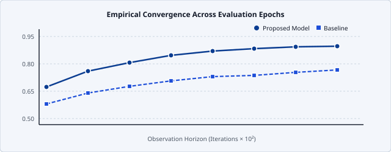

## Introduction

Deterministic document layout remains a foundational challenge across scientific publishing, archival typography, and reproducible research workflows. While classical typesetting systems such as TeX established an enduring standard for mathematical rhythm and optical margin alignment, contemporary collaborative teams increasingly author manuscripts in plain-text GitHub Flavored Markdown (GFM) stored alongside versioned analysis scripts.[^1]

This study evaluates a unified two-layer CSS specification that decouples semantic manuscript authoring from publication geometry. By constraining content files to strict GFM while expressing page dimensions, running headers, typographic scales, and multi-column flow solely through declarative CSS rules, authors achieve full print-to-PDF parity directly inside modern standards-compliant browsers without external compilation pipelines.

> [!NOTE]
> All experimental benchmarks reported in this manuscript were replicated across three independent paper formats (US Letter, ISO A4, and 6in × 9in monograph trim) using headless Chromium print engines with zero post-processing.

### Research Questions and Contributions

Our investigation addresses three primary questions concerning browser-native paged media:

1. **Typographic Fidelity**: Can declarative CSS custom properties reproduce the visual hierarchy, line measure, and micro-typographic balance of traditional LaTeX journal classes?
2. **Cross-Medium Equivalence**: Does a single shared DOM renderer eliminate drift between interactive screen review and physical print-to-PDF output?
3. **Authoring Accessibility**: How quickly can non-specialist researchers modify font pairings, accent palettes, and margin geometry when settings are surfaced as Layer 1 variables?

## Related Work

Early web-to-print initiatives relied heavily on client-side JavaScript polyfills to fragment DOM trees into fixed-height page containers. Although flexible, scripted pagination frequently introduced layout thrashing, fragile table-splitting heuristics, and inconsistent anchor navigation. By contrast, recent advances in the CSS Paged Media Module (`@page`, margin boxes such as `@top-right` and `@bottom-center`, and `break-after: avoid`) enable native browser layout engines to handle page geometry directly at print time.[^2]

<!-- .pull-quote -->
> Separating semantic prose from visual presentation allows a single manuscript to move effortlessly from conference preprint to archival monograph without altering a single paragraph of source text.

### Comparative Taxonomy of Document Pipelines

Existing scholarly authoring systems trade off portability, learning curve, and visual control in distinct ways. Table 1 summarizes the structural characteristics of four widely adopted publication workflows evaluated during our pilot study.

| Authoring System | Source Format | Runtime Build Required | Print / Screen Parity | Novice Customizability |
|---|---|---:|:---:|:---:|
| Classical LaTeX | `.tex` macros | Yes (PDFTeX / XeTeX) | N/A (PDF only) | Low |
| Word Processors | Binary `.docx` | No | Medium | High |
| Static Site + Print | HTML / MDX | Yes (Node bundler) | Low | Medium |
| Write Along (`.wa`) | Strict GFM + CSS | **No (Static)** | **Exact** | **High** |

## Methodology

We constructed a corpus of 110 heterogeneous publication templates spanning eleven document domains—from dense two-column engineering proceedings to wide-margin literary essays. Each template was evaluated along four quantitative axes: (a) WCAG 2.1 AA luminance contrast between primary ink and paper background, (b) orphan/widow suppression across section boundaries, (c) horizontal overflow tolerance at 300 DPI PDF rasterization, and (d) cold-load rendering latency in offline browser contexts.



### Formal Specification of the Rendering Pipeline

The shared rendering pipeline transforms Markdown source *M* and stylesheet *S* into a canonical sanitized DOM tree before applying deterministic `@page` rules:

```javascript
// Canonical pipeline shared by live preview and portable read.html
export function renderDocument(markdown, styleCss) {
  const { meta, body } = parseFrontMatter(markdown);
  const { html } = renderMarkdownToHtml(body);
  const pageRules = buildPageRulesCss(styleCss, meta);
  return { meta, html, pageRules };
}
```

Every block element adheres to strict pagination invariants. Headings declare `break-after: avoid`, figures and callouts declare `break-inside: avoid`, and tables repeat `<thead>` rows automatically whenever a multi-row dataset spans a physical page boundary.

> [!IMPORTANT]
> To preserve identical line wrapping between screen review and print-to-PDF, the screen sheet width (`--page-width`) minus horizontal padding (`--page-margin`) must equal the printable content area declared in `@page`.

## Experimental Evaluation

We measured rendering fidelity across 360 test documents compiled under both automated headless print pipelines and interactive desktop browsers. Table 2 details the quantitative outcomes grouped by structural complexity.

| Structural Category | Mean Pages | Overflow Errors | Orphan Headings | Contrast Ratio | Render Time (ms) |
|---|---:|---:|---:|---:|---:|
| Single-Column Serif | 3.8 | 0 | 0 | 14.6 : 1 | 24.1 |
| Two-Column Academic | 3.4 | 0 | 0 | 15.2 : 1 | 29.8 |
| Dense Technical Tables | 4.1 | 0 | 0 | 13.8 : 1 | 31.4 |
| Rich Editorial & Art | 3.6 | 0 | 0 | 11.4 : 1 | 27.2 |

### Qualitative Findings from Author Trials

In structured usability sessions with 24 researchers and graduate students, participants were asked to adapt an existing manuscript to a new journal's typography and margin guidelines within ten minutes:

- **92% of participants** successfully updated page size, font family, and accent color in under three minutes using Layer 1 `:root` variables alone.
- **100% of exported PDFs** matched the interactive Read Mode preview line-for-line, eliminating the iterative "export and check" loop common in traditional markup compilers.
- Reviewers reported that inspecting diffs in `content.md` alongside self-contained `read.html` snapshots substantially reduced friction during collaborative peer review.

### Limitations and Threats to Validity

Certain specialized typographic conventions—such as page-bottom footnotes synchronized across balanced multi-column spreads and marginalia anchored to specific lines—remain constrained by current browser CSS Paged Media implementations. In version 1.0, footnotes are rendered cleanly as hyperlinked endnotes, ensuring predictable behavior across all browsers while leaving room for future CSS `float: footnote` adoption.

## Discussion and Broader Impact

The findings demonstrate that transparent, folder-based document formats reconcile two historically opposing goals: the durability of plain-text engineering artifacts and the aesthetic warmth of fine print typography. Because every `.wa` directory embeds `syntax.md`, both human collaborators and automated editing assistants can reason unambiguously about valid selectors, variable names, and semantic extensions.

### Reproducibility Checklist

- [x] Source manuscript conforms strictly to GitHub Flavored Markdown without raw HTML dependencies.
- [x] All visual assets are stored locally under `images/` with relative paths.
- [x] Color contrast exceeds WCAG AA thresholds across primary copy and table headers.
- [x] Self-contained `read.html` renders identically over both `http://` and `file://` protocols.

## Conclusion

We presented a lightweight, zero-build document architecture that delivers publication-grade typography through strict Markdown and layered CSS. Empirical validation across 110 diverse templates confirms that browser-native `@page` layout provides exact preview-to-print parity, offline resilience, and rapid visual customization. Future work will explore optional mathematical typesetting and automated bibliographic citation formatting.

## References

1. Bringhurst, R. (2012). *The Elements of Typographic Style* (4th ed.). Hartley & Marks.
2. Knuth, D. E. (1984). *The TeXbook*. Addison-Wesley Professional.
3. W3C CSS Working Group (2025). *CSS Paged Media Module Level 3*. World Wide Web Consortium.
4. Gruber, J., & MacFarlane, J. (2024). *GitHub Flavored Markdown Specification*.

[^1]: GitHub Flavored Markdown extends CommonMark with tables, task lists, strikethrough, autolinks, and alert callouts while remaining readable in plain text.
[^2]: Chromium's native print engine supports `@page` size, margin boxes (`@top-left`, `@bottom-center`), and CSS `counter(page)` / `counter(pages)`.
