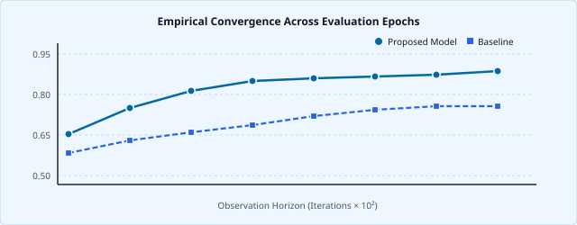

## Course & Module Overview

Welcome to **Unit 4: Statistical Inference, Experimental Design, and Reproducible Analysis**. Across the next three weeks, students will move from descriptive probability distributions to formal hypothesis testing, confidence intervals, and power calculations using real-world ecological and civic datasets.[^1]

By the conclusion of this module, every learner should be able to formulate a falsifiable null hypothesis, select an appropriate test statistic while verifying its underlying assumptions, and communicate uncertainty clearly in both written reports and visual plots.

> [!IMPORTANT]
> **Assessment Notice**: Problem Set 4 is due Friday at 5:00 PM via the course portal. Show all intermediate algebra, report exact p-values alongside effect sizes, and include brief written interpretations in plain English.

### Learning Objectives

1. Distinguish between **sampling error**, **measurement bias**, and **confounding variables** in observational versus randomized studies.
2. Compute and interpret 95% confidence intervals for population means and proportions without falling into common probability misconceptions.
3. Conduct one-sample, two-sample, and paired t-tests, evaluating normality and variance assumptions graphically.
4. Explain the relationship between sample size (*n*), significance threshold (*α*), effect size (*d*), and statistical power (*1 − β*).

## Core Concepts & Worked Formulas

When drawing independent observations *x₁, x₂, …, xₙ* from a population with mean *μ* and standard deviation *σ*, the Central Limit Theorem ensures that the sampling distribution of the sample mean *x̄* approaches normality as *n* grows, with standard error SE = *s / √n*.

| Statistical Test | Data Type | Key Assumptions | Primary Statistic |
|---|---|---|---|
| One-Sample t-Test | Continuous | Independence, approx. normality | *t* = (*x̄* − *μ₀*) / (*s / √n*) |
| Two-Sample Welch t | Continuous | Independent groups (unequal var OK) | Welch–Satterthwaite *t* |
| Chi-Square Goodness | Categorical | Expected cell count ≥ 5 | *χ²* = Σ (*O* − *E*)² / *E* |
| Linear Regression | Paired Continuous | Linearity, homoscedasticity | Slope *b₁*, *R²*, residual *F* |



### Worked Example — Water Quality Monitoring

A coastal monitoring team collects *n* = 36 independent dissolved-oxygen readings downstream from a restored wetland, finding sample mean *x̄* = 8.42 mg/L and sample standard deviation *s* = 1.08 mg/L. They test whether the mean exceeds the historical baseline of *μ₀* = 8.00 mg/L at *α* = 0.05.

```python
import math

n, xbar, mu0, s = 36, 8.42, 8.00, 1.08
se = s / math.sqrt(n)          # 0.18 mg/L
t_stat = (xbar - mu0) / se     # 2.333 (df = 35)
ci_low, ci_high = xbar - 2.03 * se, xbar + 2.03 * se
print(f"SE={se:.3f}, t={t_stat:.3f}, 95% CI=[{ci_low:.2f}, {ci_high:.2f}]")
```

Because *t* = 2.333 with 35 degrees of freedom yields a two-sided *p* = 0.0255 < 0.05 and the 95% confidence interval [8.05, 8.79] lies strictly above 8.00, we reject *H₀* and conclude that dissolved oxygen increased modestly following restoration.

> [!TIP]
> **Exam Strategy**: Always report **practical significance** alongside statistical significance. With a huge sample (*n* = 50,000), a tiny 0.02 mg/L shift can be statistically significant while remaining ecologically trivial.

## Guided Practice Problems

### Problem 1 — Experimental Design Critique (20 pts)
A municipal transit agency installs brighter LED signage at 12 downtown bus stops and observes a 9% ridership increase during September compared with August. Identify **two distinct confounding variables** that threaten a causal claim, and propose a randomized or difference-in-differences study design to isolate the true signage effect.

### Problem 2 — Confidence Interval Interpretation (20 pts)
A poll of 400 registered voters estimates 54% support for a new library bond with a 95% confidence interval of `[49.1%, 58.9%]`. Explain in two concise sentences why it is incorrect to claim *"there is a 95% probability that the true support lies inside this specific interval,"* and provide a correct frequentist interpretation.

### Problem 3 — Power & Sample Size Planning (25 pts)
Before launching a classroom reading intervention, researchers expect a moderate effect size (*d* = 0.40) and require 80% power at *α* = 0.05. Discuss how increasing class cluster size versus recruiting additional independent schools affects effective sample size.

## Weekly Study & Lab Schedule

| Week | Lecture Topic | Reading Assignment | Lab Deliverable |
|---|---|---|---|
| Week 10 | Sampling Distributions & CLT | Ch. 7 (§7.1–7.4) | Simulation Notebook #4 |
| Week 11 | Hypothesis Testing & Errors | Ch. 8 (§8.1–8.5) | Wetland Data Analysis |
| Week 12 | Regression & Model Diagnostics | Ch. 9 (§9.1–9.3) | Draft Capstone Poster |

### Student Preparation Checklist

- [x] Complete pre-lecture reading notes and bring calculator to seminar
- [x] Verify Python / R notebook environment runs cleanly offline
- [ ] Attend Thursday office hours if any residual-plot diagnostics look unclear
- [ ] Submit peer-review feedback for two classmates by Sunday evening[^2]

[^1]: Course readings draw from *OpenIntro Statistics* (4th Edition, CC BY-SA 3.0).
[^2]: Academic integrity policy: collaboration on conceptual discussion is encouraged; all submitted code and prose must be your own.


## Extended Concept Bank & Diagnostic Quick-Cards

### Card 1 — Type I vs. Type II Errors
A **Type I error (false positive, probability α)** occurs when we reject a true null hypothesis. A **Type II error (false negative, probability β)** occurs when we fail to reject a false null hypothesis. Statistical power (*1 − β*) rises with larger sample size *n*, larger true effect size *d*, and lower measurement noise *σ*.

### Card 2 — Residual Diagnostics for Linear Regression
Before trusting regression slope p-values or prediction intervals, inspect four diagnostic plots: (1) residuals versus fitted values to verify linearity and constant variance, (2) a normal Q-Q plot of standardized residuals, (3) Cook's distance to identify high-leverage influential points, and (4) autocorrelation plots whenever observations are collected sequentially over time.

### Card 3 — Multiple Comparisons Control
Running twenty independent hypothesis tests at α = 0.05 yields a 64% chance of observing at least one spurious "significant" result by pure luck. Apply **Bonferroni correction** (*α / m*) for strict family-wise error control, or the **Benjamini–Hochberg procedure** to control the False Discovery Rate (FDR) in exploratory studies.

### Card 4 — Checklist Before Submitting Lab Reports

- State the scientific question, population of interest, and sampling mechanism in plain prose.
- Report both point estimates and 95% confidence intervals with physical units intact.
- Include exact sample sizes, missing-data handling rules, and reproducible script versions.
