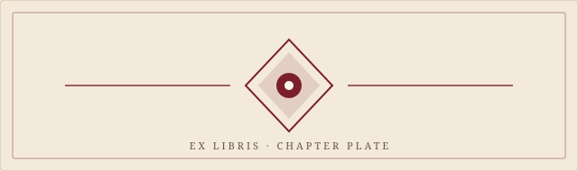

**Ms. Margaret Chen**  
Director of Institutional Partnerships  
Pacific Civic Foundation  
420 Montgomery Street, Suite 1800  
San Francisco, CA 94104

**Subject:** Formal Proposal for the 2027 Regional Archival & Literacy Fellowship

Dear Ms. Chen,

I am writing on behalf of our editorial and research team to submit our formal application and detailed partnership proposal for the **2027 Regional Archival & Literacy Fellowship**. Following our productive conversation at the Civic Design Symposium last month, we have refined our implementation timeline, community outreach milestones, and open-access publishing commitments so that every public library in the six-county consortium can participate without recurring software licensing costs.[^1]

Over the past four years, our initiative has helped 38 community archives, municipal history societies, and public high schools transition fragile paper holdings into durable, plain-text digital editions. Unlike proprietary publishing platforms that lock civic records behind vendor subscriptions, our open folder-based `.wa` standard guarantees that local historians can inspect, print, and preserve their collections decades from now using nothing more than an ordinary web browser.

> [!NOTE]
> Complete financial statements, letters of endorsement from four county library directors, and sample archival editions are enclosed in the accompanying digital dossier.

## Scope of the Proposed Fellowship Program

If awarded, the twelve-month fellowship will fund three concrete deliverables designed to deliver lasting institutional capacity rather than temporary project staffing:

1. **Public Digitization Workshops**: Twelve hands-on weekend clinics hosted across partner branches, training 180 librarians, educators, and student volunteers in clean Markdown transcription, accessible CSS typography, and archival print preparation.
2. **Open-License Template Library**: Twenty bespoke, WCAG-compliant civic publication templates tailored for oral history transcripts, local museum catalogs, municipal annual reports, and student literary journals.
3. **Offline Preservation Toolkit**: Zero-dependency static web packages that run entirely offline on reading-room workstations and produce print-identical PDF editions for physical library binding.

<!-- .pull-quote -->
> Civic memory endures only when the tools required to read, edit, and reprint it remain permanently in public hands.

## Proposed Budget & Matching Contributions

To ensure strong fiscal stewardship, our coalition has secured 40% matching support through in-kind university server hosting, donated flatbed book scanners, and faculty advisory hours. Table 1 outlines the full grant request and matching allocation.

| Budget Category | Grant Request | Matching Support | Total Value | Key Deliverable |
|---|---:|---:|---:|---|
| Workshop Instruction & Stipends | $28,000 | $8,500 | $36,500 | 12 regional clinics (180 trainees) |
| Archival Template Engineering | $18,500 | $12,000 | $30,500 | 20 open-license `.wa` templates |
| Print Proofing & Binding Copies | $9,200 | $4,000 | $13,200 | Archival reference copies for 38 branches |
| Accessibility & Audit Review | $6,300 | $3,500 | $9,800 | WCAG AA + print fidelity verification |
| **Total Program Budget** | **$62,000** | **$28,000** | **$90,000** | **12-Month Full Consortium Rollout** |

## Twelve-Month Implementation Schedule

- **Quarter 1 (Jan–Mar)**: Finalize consortium memoranda of understanding, publish open-source archival templates, and open workshop registration across all six counties.
- **Quarter 2 (Apr–Jun)**: Conduct the first six regional clinics and digitize twelve flagship oral history collections with full print proofing.
- **Quarter 3 (Jul–Sep)**: Complete remaining six clinics, incorporate librarian usability feedback, and publish the bilingual educator's handbook.
- **Quarter 4 (Oct–Dec)**: Host the public Regional Archives Showcase, distribute bound archival editions to every branch, and submit the final audited impact report.

### Pre-Award Readiness Checklist

- [x] Signed fiscal sponsorship confirmation and 501(c)(3) determination letter attached
- [x] Letters of commitment received from six regional public library systems
- [x] Open-license font and software compliance audit verified
- [ ] Schedule site visit and live demonstration with the Foundation Grants Committee

We would welcome the opportunity to meet with you and your review committee at your convenience to walk through sample printed folios and answer any questions regarding our methodology or budget. Thank you sincerely for your thoughtful consideration and for the Foundation's enduring investment in public literacy and regional heritage.[^2]

With warm regards,

---

**Dr. Clara Vance**  
Executive Director, Open Archival Press  
clara.vance@openarchivalpress.org · (415) 555-0194

*Enclosures: Audited Financial Summary; Consortium Endorsement Letters; Sample Archival Folio.*

[^1]: All workshop materials and templates produced under this fellowship will be released under the CC BY-SA 4.0 and MIT open licenses.
[^2]: Direct inquiries regarding matching university contributions may be routed to the Office of Sponsored Programs, Ref. #2027-OAP-08.
