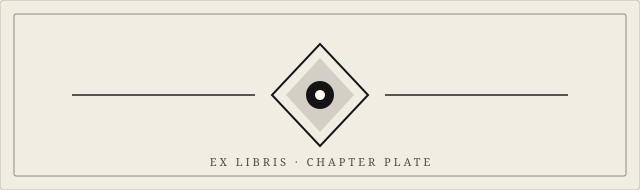

## The Quiet Renaissance of Independent Print

Walk into almost any neighborhood bookshop from Lisbon to Kyoto and you will notice an unexpected sight beside the coffee counter: thick, tactile independent magazines printed on uncoated cream stock, their covers set in bold serif headlines and generous margins. Ten years after analysts predicted the total extinction of long-form periodical design, small editorial studios are thriving precisely because readers have grown weary of endless algorithmic feeds.[^1]

What changed is not nostalgia—it is the economics of craft. Modern browser-native typesetting and short-run digital presses have collapsed the barrier between an idea drafted in plain Markdown and a crisp, collectible quarterly issue. A two-person editorial team can now design a forty-page monograph with museum-grade typography in a single afternoon.

<!-- .pull-quote -->
> "Readers don't want more content. They want fewer pages, better paper, and the feeling that a human editor cared where every sentence landed."

### Inside Three Studios Redefining Editorial Rhythm

We spent six weeks visiting independent publishers who bridge digital reading and physical print using unified stylesheets. Their secret is disarmingly practical: treat every article as structured plain text, build a disciplined modular type scale, and let whitespace do half the storytelling.

| Publication | City | Frequency | Trim Size | Signature Typeface |
|---|---|---|---|---|
| *Northbound Quarterly* | Portland | Quarterly | 8.5 × 11 in | Playfair Display & Lora |
| *Atelier Monograph* | Milan | Biannual | A4 Portrait | Cormorant Garamond |
| *Signal & Noise* | Zurich | Monthly | Letter (2-Col) | Inter & IBM Plex Mono |
| *Fieldnotes Press* | Kyoto | Seasonal | A5 Pocket | Crimson Pro |

> [!TIP]
> **Designer's Margin Rule**: Aim for 55 to 72 characters per line in single-column essays, or 38 to 48 characters per column in two-column magazine spreads.

## Feature Dispatch: The Craft of Slow Reporting

In an era measured in push notifications, slow reporting feels almost subversive. *Northbound Quarterly* assigns a single writer and a single illustrator to each story for ninety days. There are no breaking updates, no pop-up banners, and no embedded autoplay videos—only reported prose, carefully drawn diagrams, and an unhurried table of facts at the close of each section.

### Five Editorial Principles Worth Stealing

1. **Lead with a human scene**: Anchor abstract ideas in a physical room, a specific morning, or a concrete object before zooming out to data.
2. **Respect the reader's eye**: Pair one expressive display typeface with a calm, high-x-height text face—never let ornaments compete with comprehension.
3. **Design for print first**: A page that balances cleanly on physical Letter or A4 paper almost always reads effortlessly on a tablet or laptop screen.
4. **Edit ruthlessly**: Trim 15% of every first draft so the surviving sentences carry genuine cadence and surprise.
5. **Preserve an open archive**: Publish every issue in durable HTML and PDF editions so stories remain readable twenty years after launch.

## Dispatch Notes & Culture Briefs

### Architecture — Timber Libraries of the North
Municipal planners across Scandinavia are turning to cross-laminated timber for new branch libraries, pairing acoustic warmth with daylight reading halls that require zero artificial lighting from April through September.

### Typography — The Open-Font Boom
Over the past decade, Open Font License (OFL) families such as EB Garamond, Source Serif 4, and Space Grotesk have narrowed the aesthetic gap between free community typefaces and historic foundry specimens to near zero.

### Reader Checklist for Launching Your Own Zine

- [x] Pick a clear editorial focus and publish a 3-issue thematic calendar
- [x] Lock in a two-font pairing and a disciplined three-color palette
- [ ] Gather three long-form dispatches, one data table, and original illustrations
- [ ] Proof a physical test copy at 100% scale before opening subscriptions

---

## Colophon & Subscriber Notes

Every dispatch in this issue was authored in strict GitHub Flavored Markdown and typeset directly in the browser without proprietary layout licenses. Readers wishing to remix our column grids, pull-quote rules, or running headers can inspect `style.css` directly inside the `.wa` package.[^2]

[^1]: Independent Print Circulation Survey, International Periodical Designers Guild (2026).
[^2]: All photography placeholders and geometric plates are rendered as resolution-independent vector SVG graphics for crisp 300+ DPI printing.

## Extended Essay: Paper, Ink & The Future of Long-Form Reading

Across three continents, small presses and civic periodicals are converging on a surprisingly practical insight: readers finish far more long-form journalism when it is delivered in finite, well-proportioned issues rather than infinite scrolling feeds. Finite editions create a natural beginning, middle, and close—giving complex reporting space to breathe while honoring the reader's time.

### Studio Production Notes

When laying out a two-column periodical, optical balance matters more than mathematical rigidity. Subheads should break up long stretches of prose every 250–350 words, pull quotes should echo a genuine turning point in the argument rather than repeating an opening sentence verbatim, and tables should span the full measure whenever numeric comparisons require four or more columns.

- **Paper Weight Recommendation**: 100–120 gsm uncoated natural stock minimizes glare under reading lamps while preventing ink show-through on dense spreads.
- **Line Measure Check**: Keeping column widths between 3.1 and 3.6 inches yields an effortless 42–48 character measure at 9.5pt serif.
- **Archival Export**: Always preserve the original `.wa` folder alongside the press-ready PDF so future anthologies can re-typeset individual dispatches at any trim size.

### Letters to the Editor

> "Your autumn issue on timber branch libraries inspired our town council to commission a daylight reading room study. Thank you for publishing both the architectural drawings and the municipal budget table in full." — *K. Lindholm, Trondheim*

> "As an independent student editor, being able to tweak `--accent-color` and `--body-font` directly in CSS and immediately print a clean proof copy cut our layout weekend in half." — *M. Alvarez, Austin*
