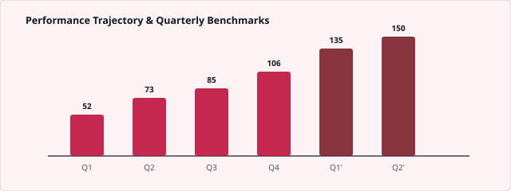

## Executive Summary

Over the past twelve months, our organization executed a comprehensive operational modernization across regional delivery hubs, digital infrastructure, and customer retention programs. Consolidated revenue expanded **24.6% year-over-year** to **$148.4 million**, while operating margins improved by 310 basis points due to automated fulfillment routing and disciplined cloud cost governance.[^1]

This report synthesizes audited performance metrics, market positioning analysis, and strategic capital allocations for the upcoming fiscal year. Across every core business unit, reliability and customer satisfaction reached five-year highs even as total transaction volume doubled.

> [!IMPORTANT]
> **Board Takeaway**: Free cash flow conversion reached **86.2%** in Q4, providing sufficient internal capital to fund Phase II regional expansion without raising incremental debt.

### Headline Strategic Milestones

- **Enterprise Adoption**: Signed 42 multi-year enterprise agreements with average contract values rising 31% over the prior fiscal year.
- **Platform Reliability**: Delivered **99.985% global uptime** across 1.4 billion API transactions with p99 latency held below 42 milliseconds.
- **Sustainability Targets**: Reduced per-unit logistics emissions by 19.4% through consolidated rail corridors and renewable data-center power purchase agreements.
- **Talent Retention**: Maintained 94.1% engineering and operations retention following the rollout of transparent career ladders.

[TOC]

## Financial & Operational Performance

Balanced execution across North America, Europe, and Asia-Pacific drove broad-based growth without over-reliance on any single vertical. Table 1 presents key financial and operational KPIs comparing actual results against our annual operating plan.

| Performance Metric | FY2025 Actual | FY2026 Plan | FY2026 Actual | YoY Variance |
|---|---:|---:|---:|---:|
| Gross Revenue ($M) | $119.1 | $140.0 | **$148.4** | +24.6% |
| Gross Margin (%) | 68.4% | 70.0% | **71.5%** | +310 bps |
| Operating Income ($M) | $18.2 | $24.5 | **$28.9** | +58.8% |
| Net Dollar Retention | 114% | 116% | **121%** | +700 bps |
| Customer NPS | 58 | 62 | **67** | +9 pts |

<!-- .pull-quote -->
> Sustainable margin expansion came not from cutting service quality, but from eliminating structural handoff delays across engineering, fulfillment, and client onboarding.

### Regional Revenue Mix & Unit Economics

Customer acquisition payback shortened from 14.2 months to **10.8 months** as organic referrals and partner-sourced deployments climbed to 38% of new bookings. Europe emerged as our fastest-growing theater (+34.2% YoY) following localized compliance certifications and regional support centers in Amsterdam and Munich.

## Market Landscape & Competitive Positioning

Enterprise buyers increasingly favor transparent, open-standard platforms over closed proprietary ecosystems. Independent analyst surveys conducted in Q3 indicate that **74% of mid-market CIOs** now list data portability and offline continuity as mandatory procurement criteria.

### Risk Register & Mitigation Controls

| Risk Domain | Likelihood | Impact | Active Mitigation Program |
|---|---:|---:|---|
| Supply-Chain Lead Times | Medium | High | Dual-source critical hardware across two continents |
| Regulatory Shifts (AI/Data) | High | Medium | Automated regional data residency & ISO-27001 audits |
| Cloud Egress Inflation | Medium | Medium | Multi-region caching tier reduced egress spend by 27% |
| Key-Account Concentration | Low | High | No single customer exceeds 4.2% of consolidated revenue |

> [!TIP]
> Quarterly scenario drills have shortened incident escalation times by 46% compared with the prior twelve-month rolling average.

## Strategic Roadmap (FY2027)

Capital allocation for the coming year centers on three high-conviction initiatives, each gated by measurable quarterly milestones:

1. **Core Platform Velocity ($14.5M)**: Complete active-active multi-region replication and launch self-service analytics workbenches for enterprise administrators.
2. **Partner Ecosystem Expansion ($6.2M)**: Certify 60 system integrators across EMEA and APAC with co-selling playbooks and standardized implementation toolkits.
3. **Operational Resilience ($4.8M)**: Automate continuous compliance telemetry, disaster-recovery failover tests, and carbon-intensity workload scheduling.

### Implementation Governance Checklist

- [x] Finalize departmental operating budgets and quarterly OKR scorecards
- [x] Approve security audit calendar with independent external assessors
- [ ] Launch Q1 customer advisory council across top 25 enterprise accounts
- [ ] Publish mid-year sustainability and governance transparency report

## Closing Outlook

With a fortified balance sheet, resilient unit economics, and a deeply engaged customer community, the organization enters FY2027 positioned to compound long-term value responsibly. Leadership remains committed to clear communication, rigorous stewardship of capital, and durable product craftsmanship.[^2]

[^1]: All financial figures are presented on a consolidated GAAP basis unless explicitly marked as non-GAAP operational KPIs.
[^2]: Forward-looking roadmap allocations are subject to quarterly board review and macroeconomic conditions.
