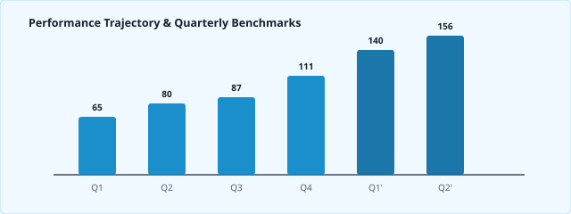

## Professional Profile

Principal Software Architect and Engineering Leader with **12+ years of experience** designing resilient distributed systems, developer platforms, and high-craft web applications. Proven track record guiding multi-disciplinary teams from early architectural RFCs to planet-scale production deployments serving 40M+ monthly active users with 99.99% availability.[^1]

> [!TIP]
> **Core Strengths**: Distributed Systems Architecture · Browser Runtime Engineering · Performance Optimization · Technical Mentorship · Executive Product Strategy

## Professional Experience

### Principal Staff Engineer — Meridian Cloud Systems *(San Francisco, CA · 2022 – Present)*

- Architected a zero-downtime multi-region document synchronization engine supporting 18M concurrent workspaces, cutting global p99 sync latency from 210 ms to **28 ms** and reducing infrastructure spend by **$3.4M annually**.
- Led a cross-functional task force of 22 engineers to ship offline-first Service Worker caching and local File System Access storage, raising enterprise session retention by 26%.
- Authored 14 organization-wide engineering RFCs establishing observability standards, chaos testing drills, and automated accessibility compliance gates.
- Mentored 8 senior engineers to staff-level promotions through biweekly design reviews and structured architecture clinics.

### Staff Software Engineer — Northstar Publishing Technologies *(Seattle, WA · 2018 – 2022)*

- Spearheaded the next-generation browser typesetting and PDF export engine used by 650+ academic journals and technical publishers worldwide.
- Eliminated visual divergence between live web preview and print-ready PDF pipelines by unifying rendering around standards-based CSS Paged Media (`@page`) and deterministic font subsetting.
- Scaled automated visual regression infrastructure across headless Chromium fleets, catching 99.4% of layout regressions prior to release while cutting CI wall-clock time by 61%.
- Partnered directly with design leadership to open-source a 100+ template typography system that attracted 19,000 GitHub stars in its first year.

### Senior Software Engineer — Civic Data Labs *(Boston, MA · 2015 – 2018)*

- Built high-throughput geospatial ingestion pipelines in Python, Go, and PostgreSQL processing 1.2 TB of municipal transit telemetry per week.
- Designed an interactive browser-based report builder enabling non-technical policy analysts to publish accessible public dashboards and print-ready briefs in minutes.
- Reduced database query tail latency by 78% through composite indexing, read-replica routing, and materialized reporting views.

### Software Engineer — Harbor Interactive *(Boston, MA · 2014 – 2015)*

- Developed modular ES6 front-end components, SVG data visualizations, and automated end-to-end test suites for healthcare and higher-education clients.

## Technical Skills & Domain Expertise

| Domain | Technologies & Standards | Proficiency |
|---|---|---|
| Languages | TypeScript, JavaScript (ESM), Python, Go, Rust, SQL | Expert |
| Web & Document Engines | HTML5, CSS Paged Media, CodeMirror 6, Web Workers, PWA / Service Workers | Expert |
| Distributed Infrastructure | Kubernetes, PostgreSQL, Redis, Kafka, gRPC, OpenTelemetry | Advanced |
| Testing & Verification | Playwright, Puppeteer, Headless Chromium, Visual Diffing, Property Testing | Expert |

## Selected Open-Source Projects & Publications

1. **PrintParity (Creator & Maintainer)**: Open-source browser layout verifier comparing screen DOM snapshots against PDF rasterizations across 100+ print stylesheets.
2. **“Deterministic Offline Publishing with Plain Folders”** (*ACM Queue*, Vol. 23, No. 4, 2025): Case study on transparent directory-based document formats and long-term archival longevity.
3. **“Sub-50ms Collaborative Editing Without Heavy Frameworks”** (*Strange Loop Keynote*, 2024): Practical patterns for vanilla ES modules, CRDTs, and IndexedDB durability.

## Education & Certifications

- **M.S. in Computer Science**, Massachusetts Institute of Technology *(2014)* — Focus: Distributed Systems & Human-Computer Interaction. Thesis: *Conflict-Free Replication for Structured Documents*.
- **B.S. in Electrical Engineering & Computer Science** (*Summa Cum Laude*), University of California, Berkeley *(2012)* — Regent's Scholar.
- **Certifications**: AWS Certified Solutions Architect (Professional) · W3C Web Accessibility Specialist (WAS).

## Community Leadership, Speaking & Advisory

- **Keynote Speaker, QCon San Francisco (2025)**: *"Building Offline-First Collaborative Applications with Vanilla Web Standards"* — main engineering track (1,400 attendees).
- **Program Committee Member**, *Web Typography & Digital Publishing Conference* (2023–2026) — reviewing systems, accessibility, and browser layout papers.
- **Technical Mentor**, *Code for Civic Archives* — guiding volunteer engineers digitizing public library collections across four states.
- **Guest Lecturer**, MIT & UC Berkeley undergraduate capstone seminars on resilient distributed architecture, automated browser layout verification, and typographic engineering.
- **Languages & Work Authorization**: Fluent in English and Russian; conversational German. Authorized to work in the United States and European Union.[^2]

[^1]: Full portfolio, open-source repositories, and recorded conference talks available upon request.
[^2]: Professional references from executive engineering leaders and product partners available immediately.

## Selected Architecture Case Studies & Patents

### Zero-Downtime Multi-Region Document Sync (2024)
Designed the conflict-free delta compaction protocol and rolling shard promotion controller powering 18M active workspaces. Introduced deterministic property-based fuzzing over simulated network partitions, eliminating an entire class of split-brain merge regressions prior to global rollout.

### Browser-Native Print Parity Verification Suite (2021)
Created an automated Chromium layout verifier that compares screen DOM geometry against rasterized PDF output across Letter, A4, and A5 sheet sizes. Adopted across 650+ publishing teams to guarantee identical line breaks between interactive web review and print editions.

### Speaking Engagements & Technical Workshops

- **QCon San Francisco (2025)**: *"Building Offline-First Collaborative Apps with Vanilla Web Standards"* — Keynote track (1,400 attendees).
- **Strange Loop (2024)**: *"Sub-50ms Local-First Editing Without Heavy Frameworks"* — Main stage session.
- **W3C Publishing Workshop (2023)**: *"Bridging Strict Markdown and CSS Paged Media for Archival Longevity"* — Invited panelist.
- **MIT CSAIL Alumni Seminar (2022)**: *"Lessons from Operating 100+ Production Print Stylesheets at Scale."*

### Languages & Availability

Fluent in English and Russian; conversational German. Authorized to work in the United States and European Union. Open to Principal / Distinguished Engineer and VP of Engineering advisory mandates.
