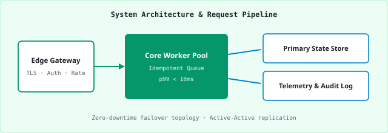

[TOC]

## 1. Overview & Architecture

The **Meridian Edge Sync Engine (v3.4)** provides low-latency, conflict-free state replication between offline-capable browser clients and geo-distributed backend clusters. Designed around deterministic JSON snapshots and idempotent write-ahead logs, the service guarantees **at-least-once delivery** with automatic client deduplication and zero-downtime regional failover.[^1]

This manual serves as both an operational reference and a hands-on integration guide for platform engineers. Every configuration snippet, API schema, and diagnostic procedure has been verified against production release `3.4.2`.

> [!IMPORTANT]
> **Breaking Change in v3.4**: Clients must include the `X-Idempotency-Key` header (UUIDv4) on all `POST /v3/mutations` requests. Unkeyed writes are rejected with `400 Bad Request`.



### Key Design Properties

- **Deterministic Conflict Resolution**: Hybrid Logical Clocks (HLC) guarantee total ordering across disconnected peers without central clock coordination.
- **Zero-Allocation Streaming**: Wire payloads use length-prefixed framing with optional zstd compression, sustaining 45,000 messages/sec per core.
- **Strict Tenant Isolation**: Every workspace is encrypted at rest using per-tenant envelope keys rotated automatically every 90 days.

## 2. Quickstart Installation

Install the CLI and verify connectivity to your staging cluster:

```bash
# Install the Meridian CLI (Linux / macOS)
curl -fsSL https://get.meridian.example/install.sh | sh

# Authenticate and inspect cluster health
meridian auth login --region us-west-2
meridian cluster status --output table
```

### Minimal Client Configuration (`meridian.toml`)

```toml
[cluster]
endpoint = "https://sync.us-west-2.meridian.example"
timeout_ms = 2500
retry_max_attempts = 4

[storage]
engine = "indexeddb"
snapshot_interval_sec = 30
compression = "zstd"
```

> [!TIP]
> Set `MERIDIAN_LOG_LEVEL=debug` locally to inspect wire-frame checksums, HLC timestamps, and retry backoff intervals in real time.

## 3. REST & Streaming API Reference

All endpoints require Bearer JWT authentication (`Authorization: Bearer <token>`) and return structured `application/json` payloads.

| Method | Endpoint | Description | Rate Limit | Idempotent |
|---|---|---|---:|:---:|
| `GET` | `/v3/workspaces/{id}` | Retrieve latest workspace manifest & head revision | 600 req/min | Yes |
| `POST` | `/v3/workspaces/{id}/mutations` | Append atomic CRDT delta batch | 300 req/min | Yes (Keyed) |
| `GET` | `/v3/workspaces/{id}/snapshots` | Download compacted binary checkpoint | 120 req/min | Yes |
| `DELETE` | `/v3/workspaces/{id}/sessions/{sid}` | Revoke active sync session token | 60 req/min | Yes |

### Example Mutation Payload

```json
{
  "workspaceId": "ws_01JH7X9K2M4P",
  "baseRevision": 4182,
  "hlc": "2026-11-26T18:42:11.004Z-0001-nodeA",
  "operations": [
    { "op": "replace", "path": "/title", "value": "Q4 Architecture Review" },
    { "op": "append", "path": "/tags", "value": "verified" }
  ]
}
```

### Standard Error Codes

| HTTP Status | Error Code | Root Cause | Recommended Action |
|---:|---|---|---|
| `400` | `INVALID_HLC_DRIFT` | Client clock exceeds ±60s skew bound | Synchronize NTP and retry |
| `409` | `REVISION_CONFLICT` | Stale `baseRevision` during strict CAS write | Pull delta stream and rebase |
| `429` | `QUOTA_EXCEEDED` | Token bucket exhausted for tenant | Apply exponential jitter backoff |
| `503` | `REGION_DRAINING` | Planned maintenance failover in progress | Fail over to secondary endpoint |

## 4. Operations Runbook & Troubleshooting

When alert `SyncQueueLagHigh` triggers (queue depth > 5,000 for 3 consecutive minutes), on-call engineers should execute the following triage sequence:

1. **Verify regional ingress health**: Check `edge_gateway_5xx_ratio` and TLS certificate expiry metrics in the primary telemetry dashboard.
2. **Inspect worker saturation**: Run `meridian ops workers top --sort queue_wait` to distinguish CPU throttling from downstream state-store lock contention.
3. **Drain unhealthy shards**: If a single partition shows elevated write latency (> 120 ms p99), shift traffic to its hot standby via `meridian ops shard promote --shard <id>`.

> [!WARNING]
> Never force-truncate the write-ahead log (`--unsafe-reset-wal`) on a live primary shard; doing so can discard uncompacted client acknowledgments.

### Production Release Verification Checklist

- [x] Unit, integration, and Jepsen-style partition tests pass 100%
- [x] Canary deployment holds < 0.01% error rate for 60 minutes
- [x] Schema migration verified backward-compatible with v3.3 clients
- [ ] Update changelog, status page, and customer release notes

## 5. Security & Compliance Notes

All transport traffic enforces TLS 1.3 with forward-secret cipher suites. Audit logs capture every administrative action with tamper-evident SHA-256 hash chaining and are retained in immutable object storage for seven years to satisfy SOC 2 Type II and ISO 27001 controls.[^2]

[^1]: Architecture specifications conform to RFC 9110 (HTTP Semantics) and RFC 8259 (JSON Data Interchange Format).
[^2]: Report suspected security vulnerabilities privately to `security@meridian.example` using our published PGP key.
